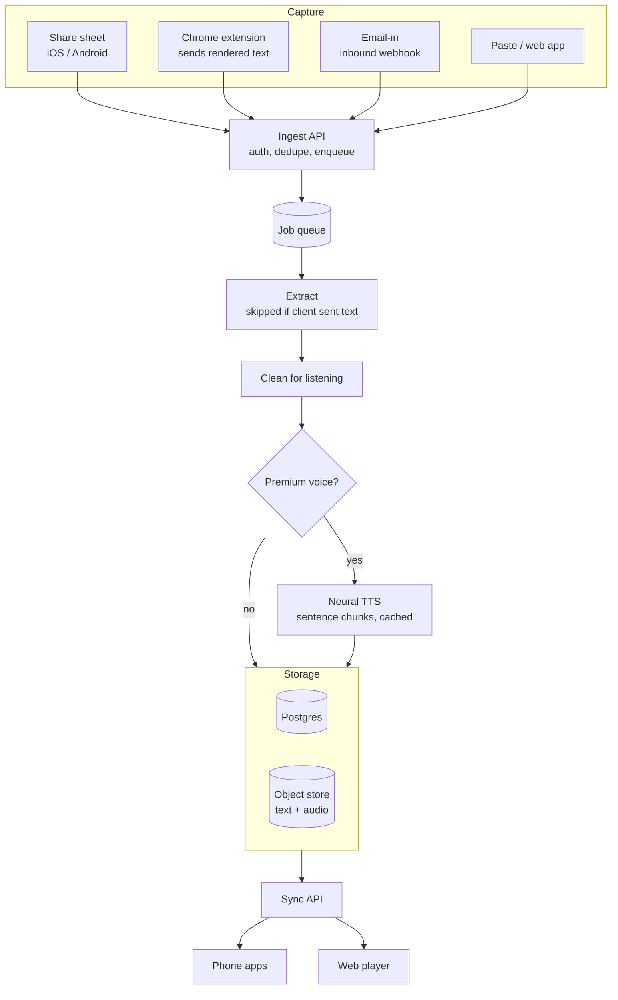

# Listen Later: Developer Handoff (MVP)

Version 1.0 · 18 October 2026 · Owner: KP (CPO)

This is the engineering brief for the MVP. The full product spec, with personas, pricing, legal and go-to-market, lives in the Claude Doc "Listen Later — Product Spec v1". Where the two disagree, the product spec wins. Raise any conflict with KP.

## 1. What we are building

Listen Later turns a person's reading list into an audio queue. Users save links or text from any app. We extract the article, clean it for listening, and play it back in order with text-to-speech. Each item keeps its place and moves from Up Next to Listened when finished.

A working browser prototype exists. It is a single HTML file using the Web Speech API, with sentence-level highlighting, resume, reordering and speed control. Treat it as the reference for player behaviour, not as production code. Two lessons from the prototype carry into the build. First, LinkedIn and similar sites return 403 to server fetches, so client-side capture is a must-have rather than a nice-to-have. Second, long utterances stall some speech engines, so speech is always chunked by sentence.

## 2. MVP scope

The MVP is everything needed for public launch. V1 and V2 items are listed only so the architecture leaves room for them. Do not build them now.

| Area | In MVP | Deferred (do not build) |
| --- | --- | --- |
| Capture | Android share intent, iOS share extension, paste in app, email-in address, Chrome extension (MV3) | WhatsApp/Telegram bot (V1), PDF upload (V1), RSS (V2), imports (V1) |
| Extraction | Server extraction, headless fallback, client-sent text path, blocked-page detection, language detection, listenability cleanup | AI summaries and chapters (V1), translation (V2) |
| Library | Up Next, In Progress, Listened, Archive; reorder; play next; swipe actions; bulk select | Auto-tags, smart playlists, search (V1) |
| Player | Continuous play, on-device voices, premium neural voices, follow-along text, lock-screen and headphone controls, offline, sleep timer | CarPlay/Android Auto (V1), watch and speakers (V2) |
| Sharing | Share an item as a public web-player link | Playlists (V1), shared queues (V2) |
| Account | Google, Apple and email magic-link sign-in; guest mode (5 items); sync; export; delete account | Teams (V2) |

## 3. Architecture

Every save, from any channel, becomes one job on a queue. Workers extract, clean and (for premium) voice it. Clients sync the result.



### Recommended stack

These are recommendations. The tech lead can change them, but write down the reason in the repo's ADR folder.

| Layer | Choice | Why |
| --- | --- | --- |
| Mobile | React Native with Expo (dev client, config plugins) | One codebase for both platforms; mature audio and share-extension support |
| Audio playback | `react-native-track-player` | Background audio, media session, lock-screen and headphone controls |
| On-device TTS | `expo-speech` (wraps AVSpeechSynthesizer and Android TextToSpeech) | Zero server cost for the free tier; works offline |
| Web app and player | Next.js on the same TypeScript monorepo | Fast public share pages that load without sign-in |
| Extension | Chrome MV3, TypeScript, Readability.js in the content script | Captures text the user can already see, including logged-in pages |
| API | Node.js (Fastify) or Python (FastAPI), team's choice | Both fine; keep one language for API and workers if possible |
| Workers | Python for extraction (Trafilatura, readability-lxml), Playwright for headless fallback | Best-in-class extraction libraries live in Python |
| Queue | Postgres-backed queue (pg-boss or Graphile Worker) at MVP; move to SQS or similar when needed | One fewer service to run |
| Database | Postgres 16 | Relational data, row-level ownership, full-text search later |
| Object store | S3-compatible bucket with a CDN in front | Text blobs and audio files |
| Inbound email | Postmark, SES or Mailgun inbound webhooks | Parsed email delivered as JSON |
| Auth | Supabase Auth, Clerk or Firebase Auth | Google, Apple and magic link without building it |
| Premium TTS | Decided in sprint 1 bake-off (see section 7) | Cost decides the business model |

## 4. Data model

```sql
create table users (
  id            uuid primary key default gen_random_uuid(),
  email         text unique,
  display_name  text,
  inbound_slug  text unique not null,        -- e.g. 'kp-7f3a' → kp-7f3a@save.listenlater.app
  plan          text not null default 'free', -- free | premium | premium_plus
  voice_pref    jsonb not null default '{}',  -- {"en": "voice-id", "hi": "voice-id"}
  rate_pref     numeric(3,2) not null default 1.00,
  created_at    timestamptz not null default now(),
  deleted_at    timestamptz
);

create type item_status as enum ('queued', 'extracting', 'ready', 'failed', 'blocked');
create type item_state  as enum ('up_next', 'in_progress', 'listened', 'archived');

create table items (
  id              uuid primary key default gen_random_uuid(),
  user_id         uuid not null references users(id) on delete cascade,
  source_url      text,                       -- null for pasted text
  canonical_url   text,                       -- after redirects; used for dedupe
  source_channel  text not null,              -- share | extension | email | paste | web
  title           text,
  site_name       text,
  author          text,
  lang            text,                       -- BCP-47, detected
  word_count      int,
  text_key        text,                       -- object-store key of cleaned text
  status          item_status not null default 'queued',
  fail_reason     text,                       -- e.g. 'http_403', 'login_wall', 'paywall', 'no_text'
  state           item_state  not null default 'up_next',
  position        double precision not null,  -- fractional ordering; reorder = one write
  progress_sentence int not null default 0,
  progress_updated_at timestamptz,
  listened_at     timestamptz,
  created_at      timestamptz not null default now(),
  updated_at      timestamptz not null default now(),
  unique (user_id, canonical_url)
);
create index on items (user_id, state, position);

create table audio_renditions (
  id          uuid primary key default gen_random_uuid(),
  item_id     uuid not null references items(id) on delete cascade,
  voice_id    text not null,
  manifest_key text not null,                 -- JSON list of chunk files with sentence ranges
  duration_ms int,
  chars_billed int not null,                  -- for the voice cost ratio metric
  created_at  timestamptz not null default now(),
  unique (item_id, voice_id)
);

create table shares (
  token       text primary key,               -- short random, URL-safe
  user_id     uuid not null references users(id) on delete cascade,
  item_id     uuid references items(id) on delete set null,
  source_url  text not null,                  -- shares carry the URL only, never our text copy
  title       text,
  created_at  timestamptz not null default now(),
  revoked_at  timestamptz
);
```

Ordering uses fractional `position` values. Moving an item between two neighbours sets its position to their midpoint, so a reorder is one row write. Renormalise a user's positions in the background when gaps get smaller than 1e-9.

Sentence boundaries are computed once on the server from the cleaned text and stored with it as a JSON array of `{start, end}` character offsets. Every client uses the same boundaries, so `progress_sentence` means the same thing on every device.

## 5. API

REST over HTTPS, JSON, bearer token from the auth provider. All list endpoints are cursor-paginated.

| Method and path | Purpose | Notes |
| --- | --- | --- |
| `POST /v1/items` | Save one or more items | Body: `{urls?: string[], text?: string, title?: string, channel, client_text?: {url, title, text}}`. Returns items with `status`. Idempotent on `canonical_url`. |
| `GET /v1/items?state=up_next` | List the queue | Ordered by `position`. |
| `GET /v1/items/:id` | Item detail | Includes `text_url` (signed) and `sentences_url`. |
| `PATCH /v1/items/:id` | Update state, position or progress | Progress writes are debounced on the client (every 8 sentences, on pause, on background). |
| `POST /v1/items/:id/retry` | Retry a failed extraction | Rate-limited. |
| `DELETE /v1/items/:id` | Delete permanently | Archive is a `PATCH` to `state=archived`. |
| `GET /v1/items/:id/audio?voice=` | Get or start a premium rendition | Returns the chunk manifest; chunks stream as they finish. Premium only. |
| `GET /v1/sync?since=` | Changes since a timestamp | Drives offline-first sync on mobile. |
| `POST /v1/shares` | Create a share link | Body: `{item_id}`. Returns `https://listenlater.app/s/:token`. |
| `GET /v1/shares/:token` | Public share lookup | No auth. Returns URL and title only. |
| `POST /v1/webhooks/inbound-email` | Inbound mail | Verify the provider signature. Map the `To` address to `inbound_slug`. |
| `GET /v1/me/export` | Export all user data | JSON download. |
| `DELETE /v1/me` | Delete account | Hard-delete within 30 days; immediate soft-delete. |

Real-time updates (an item becoming `ready`) go through the auth provider's realtime channel, or a lightweight SSE endpoint, so the app can update the badge without polling.

## 6. Extraction pipeline

Each item moves through `queued → extracting → ready`, or ends in `failed` or `blocked` with a `fail_reason`.

When the client already sent text (the extension, or share-from-browser on iOS), skip fetching and go straight to cleanup. Otherwise the worker fetches the URL with a normal browser user agent, a 10-second timeout and up to 5 redirects. It respects robots.txt and never attempts to bypass paywalls or logins. Run Trafilatura first, and Readability as the second opinion. If the result is under 150 words, retry once in headless Playwright. If it is still under 150 words, or matches login-wall patterns, mark the item `blocked` with the right reason. The app then offers "Open in browser and share" or "Paste text".

The cleanup pass prepares text for the ear. It strips captions, "related articles", share prompts, footnote markers and inline code blocks. It replaces tables with a one-line spoken note. It expands units and common abbreviations per language, collapses whitespace, and splits text into sentences, breaking any sentence over 260 characters at a comma. Store the cleaned text and the sentence array in the object store under `items/{id}/text.json`.

Build a regression test set of 500 URLs from the top publishers in our launch markets (India, UK, US). The extraction job must keep clean extraction at 95% or better on that set in CI. "Clean" means no navigation, cookie or subscription text in the first and last 300 characters, and at least 80% of the reference article's words present.

## 7. Text-to-speech

The free tier speaks on the device. The app passes each sentence to `expo-speech` in turn and advances on the `onDone` callback. Pause is implemented as stop-and-remember-index, because pause and resume are unreliable on some Android engines. Speed changes restart the current sentence. Voice choice defaults to the device voice for the item's language, preferring the user's region (for example en-IN in India).

The premium tier uses server-side neural voices. Synthesis is sentence-chunked: render the first 3 sentences immediately so playback starts in under 1.5 seconds, then render the rest in batches of about 20 sentences. Store chunks as 64 kbps Opus under `audio/{item}/{voice}/{n}.opus`, with a manifest that maps each chunk to its sentence range so follow-along highlighting stays exact. Cache per item and voice; never re-render.

Sprint 1 includes a voice bake-off. Compare three cloud vendors (shortlist: Google Cloud TTS, Azure Speech, ElevenLabs or OpenAI) against one self-hosted open-weight model on a GPU. Score each on naturalness for English (US, UK, Indian) and Hindi, latency to first chunk, and cost per listening hour. One hour is about 54,000 characters. The business needs premium voice cost below 15% of premium revenue, which in practice means the default premium voice must cost a few cents per hour. Log `chars_billed` on every rendition from day one.

## 8. Mobile specifics

On iOS, the share extension has a tight memory limit. It must only capture the URL (and selected text, if any), post it to `/v1/items`, show the confirmation and close. No extraction runs in the extension. Use an App Group so the extension can reach the auth token. Enable the Audio background mode.

On Android, register an intent filter for `ACTION_SEND` with `text/plain`. Use a translucent activity that confirms and closes without opening the full app. Run playback in a foreground media service.

Both apps are offline-first. They keep a local SQLite copy of the queue, apply changes optimistically, and reconcile with `/v1/sync`. On Wi-Fi, download cleaned text for all Up Next items, and premium audio for the next 10.

Lock-screen and headphone controls must support play, pause, skip forward 15 seconds, skip back 30 seconds and next item. Show artwork (site favicon or hero image), title and site name.

## 9. Non-functional requirements

| Requirement | Target |
| --- | --- |
| Share-to-saved confirmation | Under 1 s on 4G |
| Link saved to ready (server path) | p90 under 20 s |
| Email received to ready | p90 under 2 min |
| Tap Play to first sound | p90 under 1.5 s |
| Sync across devices | Under 5 s |
| Crash-free sessions | 99.5% or better |
| Accessibility | WCAG 2.2 AA; full TalkBack and VoiceOver support; dynamic type |
| Privacy | GDPR, India DPDP Act 2023, CCPA; encryption at rest; no reading data in analytics events beyond counts |
| Localisation | UI strings externalised from day one; RTL layouts supported; launch languages English, Hindi, Spanish, Portuguese, Arabic |

## 10. Analytics events

Instrument these from the first beta build. Never send article titles, URLs or text to analytics.

`item_saved {channel}`, `item_ready {latency_ms}`, `item_failed {reason}`, `play_started {source: app|lock|car}`, `listening_minutes {minutes, voice_tier}`, `item_listened`, `share_created`, `share_opened`, `share_install`, `paywall_shown`, `subscription_started {plan}`.

The North Star metric, weekly listening minutes per active user, is computed from `listening_minutes`.

## 11. Milestones

| Dates | Milestone | Done when |
| --- | --- | --- |
| Nov 2026 | Sprint 0–1: repo, CI, auth, data model, voice bake-off | Bake-off report with a recommended voice and cost per hour |
| Dec 2026 | Capture and extraction | All four capture channels create items; 500-URL test set running in CI |
| Jan 2027 | Player and library | Continuous play, follow-along, offline, lock-screen controls on both platforms |
| Feb 2027 | Sharing, premium voices, account | Share links play without sign-in; export and delete work; internal dogfood |
| Mar–Apr 2027 | Closed beta, 500 users in India and the UK | Gate: 95% extraction on top 500 sites; 40% activation; 99.5% crash-free |
| May 2027 | Public launch on App Store and Play Store | Store approvals; status page; on-call rota |

## 12. Open decisions

These need an answer before or during sprint 1. Each has an owner.

| Decision | Owner | Needed by |
| --- | --- | --- |
| Final product name and domain | KP | Before store listings (Jan 2027) |
| API language: Node or Python | Tech lead | Sprint 0 |
| Auth provider | Tech lead | Sprint 0 |
| Premium voice vendor or self-hosted model | Tech lead and KP | End of sprint 1 |
| Cloud provider and data region | Tech lead | Sprint 0 |
| Legal review of the share design | KP | Before beta |

## 13. Definition of done (every story)

A story is done when it works on a real iOS and Android device, not just a simulator. It has tests for its logic, and its strings are externalised. It passes an accessibility check with the screen reader on, and it emits its analytics events. Any new failure state shows the user a plain-language reason and a next step.
